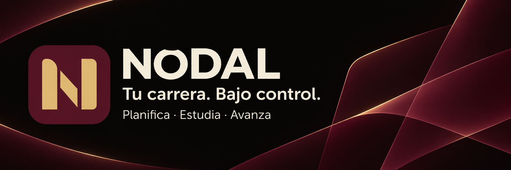

# Nodal

**Your studies. Under control.** [Español](README.md)

Nodal is a local academic organizer for Apple Silicon Macs. It combines your calendar, subject tasks, persistent study timers, reviewable rescheduling, weighted grades and questions for tutoring.

[Download](https://github.com/S3rri-dev/nodal/releases/latest) · [Installation](docs/INSTALL.md) · [Technical case study](https://github.com/S3rri-dev/S3rri-dev/blob/main/proyectos/nodal.md#english) · [Contribute](CONTRIBUTING.md) · [Report an issue](https://github.com/S3rri-dev/nodal/issues/new/choose)

The current interface and detailed guides are in Spanish. Dates use Europe/Madrid and a Monday-first calendar. The public app starts empty; all screenshots show synthetic demonstration data.

Built with Swift, AppKit, WebKit and system SQLite. No account, cloud service or runtime package downloads. Apple Silicon; deployment target macOS 13. See [verified platforms and limits](docs/VERIFICATION.md). This initial release is ad-hoc signed, not Developer ID signed or notarized.

    ./tests/run.sh
    ./tests/run-ui.sh
    ./scripts/build.sh
    ./scripts/package.sh

Code: GPL-3.0-or-later. Name and logo: [brand policy](TRADEMARKS.md). See [privacy](docs/PRIVACY.md), [security](SECURITY.md) and [third-party notices](THIRD_PARTY_NOTICES.md).
