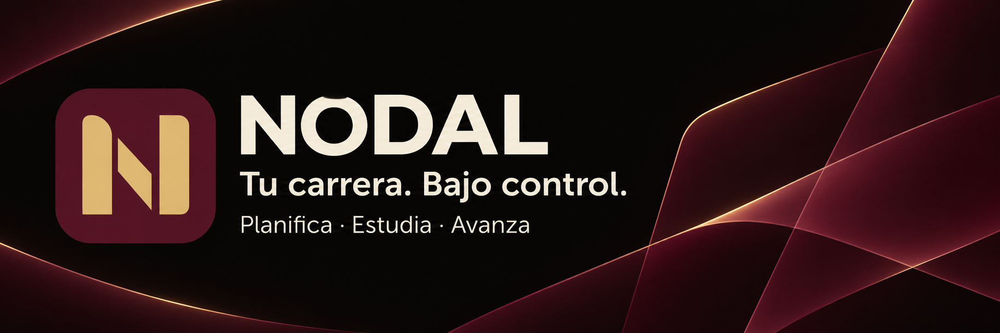
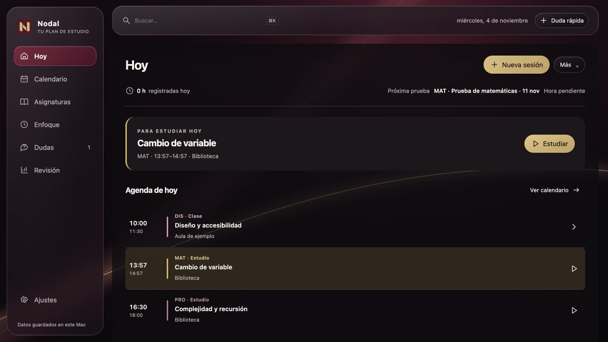
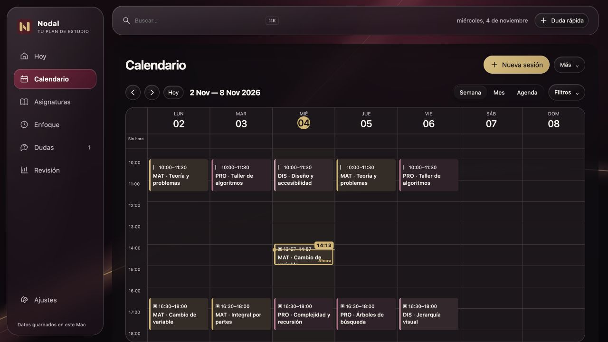
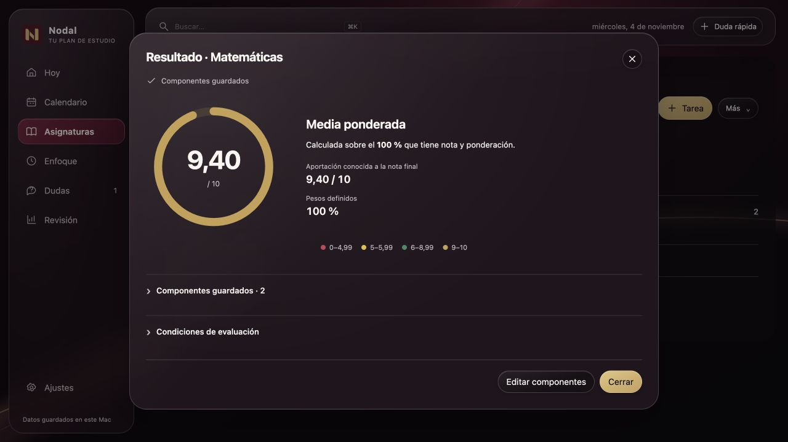
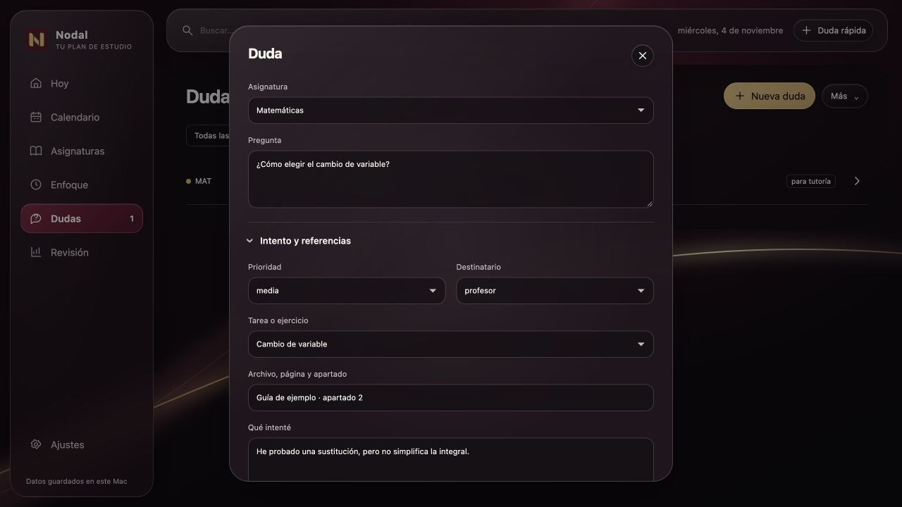
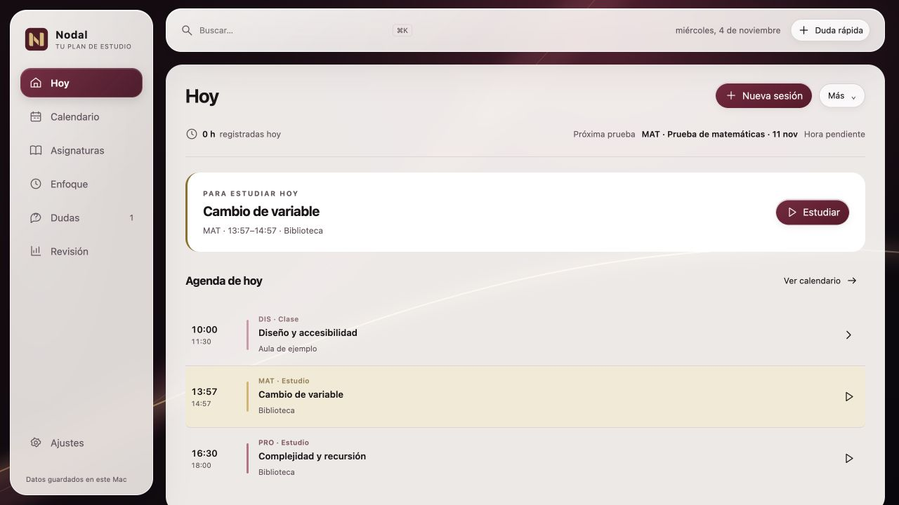

# Nodal

### Tu carrera. Bajo control.

Clases, tareas, sesiones de estudio y notas en un espacio propio para Mac.

**[Descargar para Mac](https://github.com/S3rri-dev/nodal/releases/latest)** · **[Primeros pasos](docs/GETTING_STARTED.md)** · **[Reportar un problema](https://github.com/S3rri-dev/nodal/issues/new/choose)**

Español · [English](README.en.md)

## Un plan que puedes seguir

Nodal reúne el calendario de tu curso, el trabajo pendiente y tus registros de estudio. Funciona en el Mac, sin crear una cuenta ni mantener un servidor. La versión pública empieza vacía: tú añades las asignaturas o importas tu plan.

- **Calendario propio.** Semana, mes y agenda; línea de hora actual, filtros, clases recurrentes y pruebas con hora pendiente.
- **Tareas por asignatura.** Temas, objetivos, referencias y criterios de salida. El estado de la tarea y la evidencia de aprendizaje se registran por separado.
- **Estudio con tiempo real.** Cronómetro libre o por intervalos, pausas persistentes y corrección manual con historial.
- **Reorganización revisable.** Selecciona sesiones, revisa huecos y conflictos, aplica un lote y deshazlo si lo necesitas.
- **Calculadora de notas.** Componentes editables, ponderaciones y media circular. Las notas desconocidas permanecen vacías.
- **Dudas y tutorías.** Guarda la pregunta y lo que intentaste, y exporta el contexto para consultarlo.
- **Planes actualizables.** XML validado con vista previa, conservación del progreso y copia SQLite antes de aplicar.

El nombre y las horas del calendario no acreditan asistencia ni aprendizaje. La calculadora no sustituye las reglas de evaluación de tu asignatura.

## Así se ve

Las capturas utilizan exclusivamente un plan y registros sintéticos de demostración. La descarga empieza sin esos datos.

| Tu día | Calendario semanal |
| --- | --- |
|  |  |

| Calculadora | Dudas y tutorías |
| --- | --- |
|  |  |

## Instalar

1. Descarga el archivo **Nodal-1.6.0-arm64.dmg** de [Releases](https://github.com/S3rri-dev/nodal/releases/latest).
2. Abre la imagen y arrastra **Nodal.app** a Aplicaciones.
3. Abre la aplicación y crea tu primera asignatura. También puedes importar el [plan de ejemplo](examples/plan-demo.xml).

**Apple Silicon; objetivo de compilación macOS 13 o posterior.** Las plataformas realmente comprobadas se detallan en [Verificación](docs/VERIFICATION.md).

La versión inicial lleva **firma ad hoc**, sin Developer ID ni notarización. macOS puede bloquearla al primer intento; consulta el procedimiento oficial y los límites en [Instalación](docs/INSTALL.md). No ofrecemos un comando de Homebrew ni una versión iOS.

## Tus datos se quedan en el Mac

La base y sus copias están en ~/Library/Application Support/Nodal/. No se accede a Apple Calendar, iCloud o Google Calendar. Los archivos ICS son importaciones y exportaciones, no una sincronización.

No hay cuentas de usuario, analítica, anuncios ni llamadas de red desde la interfaz. Los recordatorios son opcionales y dependen del permiso de macOS. [Privacidad](docs/PRIVACY.md) · [Permisos](docs/PERMISSIONS.md) · [Copias e importación](docs/DATA.md).

## Compilar desde el código

Necesitas un Mac con Xcode Command Line Tools, Python 3 y Node para las comprobaciones de interfaz. La app instalada no necesita Python ni Node. No utiliza paquetes descargados en tiempo de ejecución.

    git clone https://github.com/S3rri-dev/nodal.git
    cd nodal
    ./tests/run.sh
    ./tests/run-ui.sh
    ./scripts/build.sh
    ./scripts/package.sh

Para trabajar con datos separados:

    ./scripts/build.sh --dev

Esto genera **Nodal Dev.app**, con identificador y carpeta de datos propios. [Contribuir](CONTRIBUTING.md) · [Arquitectura](docs/ARCHITECTURE.md) · [Publicar una versión](docs/RELEASING.md).

## Estado y límites

Nodal está en una primera publicación para comunidad. La interfaz está en español y usa Europe/Madrid. No incluye IA conversacional, sincronización entre dispositivos ni aplicaciones móviles. Las mejoras previstas están en [Roadmap](docs/ROADMAP.md), no se presentan como funciones ya disponibles.

[Historial](CHANGELOG.md) · [Ayuda](SUPPORT.md) · [Solución de problemas](docs/TROUBLESHOOTING.md) · [Seguridad](SECURITY.md).

## Licencia e identidad

Copyright © 2026 S3rri-dev y colaboradores. Código bajo **GPL-3.0-or-later**, sin garantía; consulta [LICENSE](LICENSE). El nombre y el logo se rigen por [TRADEMARKS.md](TRADEMARKS.md). [Componentes y procedencia](THIRD_PARTY_NOTICES.md).

La organización del repositorio se ha inspirado en [vorssaint-utils](https://github.com/vorssaint/vorssaint-utils). Nodal es un proyecto independiente; no incorpora su código ni su identidad.
